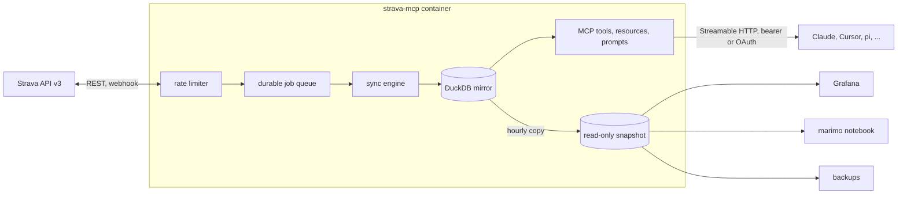

# strava-mcp

[](https://github.com/justmytwospence/strava-mcp/actions/workflows/ci.yml)
[](https://justmytwospence.github.io/strava-mcp/)
[](https://github.com/justmytwospence/strava-mcp/releases)
[](https://github.com/justmytwospence/strava-mcp/pkgs/container/strava-mcp)

An [MCP](https://modelcontextprotocol.io/) server for your own Strava account, backed by a complete local mirror of everything Strava's API returns for it, in one [DuckDB](https://duckdb.org/) file. Tools answer from the mirror in milliseconds and cost no API requests; a background sync keeps it complete and fresh within Strava's rate limits; a read-only snapshot of the same file feeds Grafana, notebooks and backups. Self-hosted with one `docker compose up -d`.



- **Everything, verbatim.** Activities with laps, splits, best efforts and every segment effort; full-resolution streams; zones; kudos, comments, photos; gear, segments, routes, clubs, the profile and a history of its totals. Each response is stored as received, a new version only when it changed, and projected into typed tables with a description and unit on every column.
- **Within the rate limits.** Usage comes from Strava's headers on every response; background work takes at most 75% of each window and spreads it over the day, so a question from you is never starved. New activities arrive through a webhook in seconds or by polling every 15 minutes.
- **Cache-first tools, 33 of them,** plus `strava_query` for read-only SQL over the whole mirror and `strava_schema` to describe it. Every answer says whether it came from the mirror or from Strava.
- **A snapshot anything can read.** DuckDB has one writer, so the server publishes a consistent copy hourly and, optionally, serves it over HTTP. Grafana, a marimo notebook and scheduled backups are optional Compose profiles over it; your own tools attach it the same way.
- **Your identity provider, optionally.** A bearer token protects `/mcp` by default; the `oauth` profile puts an OAuth 2.1 gateway in front for claude.ai, Claude Code and any client that signs in with your OIDC provider.

## Quickstart

```sh
git clone https://github.com/justmytwospence/strava-mcp.git && cd strava-mcp
cp .env.example .env                                   # STRAVA_CLIENT_ID, STRAVA_CLIENT_SECRET, MCP_BEARER_TOKEN
docker compose run --rm -p 8765:8765 strava-mcp auth   # authorize once; the app's callback domain is localhost
docker compose up -d                                   # http://<host>:8000/mcp
claude mcp add --transport http strava http://localhost:8000/mcp --header "Authorization: Bearer $MCP_BEARER_TOKEN"
```

The [quickstart](https://justmytwospence.github.io/strava-mcp/quickstart/) walks through creating the Strava API application and the first backfill; [clients](https://justmytwospence.github.io/strava-mcp/clients/) covers Claude Desktop, claude.ai, Cursor and pi.

## Documentation

[justmytwospence.github.io/strava-mcp](https://justmytwospence.github.io/strava-mcp/): [configuration](https://justmytwospence.github.io/strava-mcp/configuration/), [authentication](https://justmytwospence.github.io/strava-mcp/authentication/), [how sync works](https://justmytwospence.github.io/strava-mcp/sync/), [the mirror and the snapshot](https://justmytwospence.github.io/strava-mcp/data/), [schema reference](https://justmytwospence.github.io/strava-mcp/data/schema/), [Grafana, notebooks, backups](https://justmytwospence.github.io/strava-mcp/extras/), [operations](https://justmytwospence.github.io/strava-mcp/operations/), [tools reference](https://justmytwospence.github.io/strava-mcp/reference/tools/).

## Development

```sh
pnpm install
pnpm test            # the mirror against scrubbed payloads, chunked storage, migrations, snapshots, the limiter, the webhook, the auth command
pnpm run build
pnpm run docs:gen    # regenerate docs/reference/tools.md and docs/data/schema.md
```

See [CONTRIBUTING.md](CONTRIBUTING.md) for the layout, how to add a column or a table, and how the memory benchmark works. Images are published to `ghcr.io/justmytwospence/strava-mcp` for amd64 and arm64 by pushing a `vX.Y.Z` tag.

Strava's API Agreement restricts caching beyond seven days and use with AI applications other than Strava's own. This server is built for a single athlete's own data; whether that use is acceptable under the agreement is yours to judge. Not affiliated with Strava.

## License

MIT
