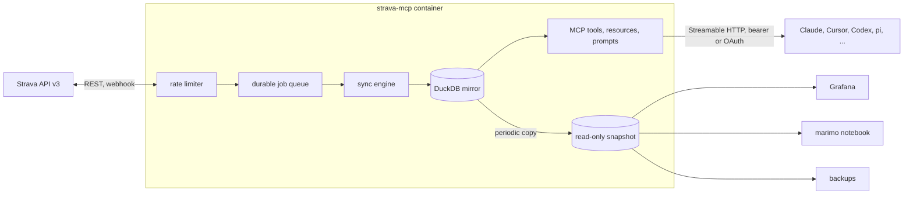

# strava-mcp

[](https://github.com/justmytwospence/strava-mcp/actions/workflows/ci.yml)
[](https://justmytwospence.github.io/strava-mcp/)
[](https://github.com/justmytwospence/strava-mcp/releases)
[](https://www.npmjs.com/package/@justmytwospence/strava-mcp)
[](https://github.com/justmytwospence/strava-mcp/pkgs/container/strava-mcp)
[](LICENSE.md)

**Ask an AI assistant anything about your Strava history, answered in milliseconds from a complete local mirror of your account.**

strava-mcp is a self-hosted [MCP](https://modelcontextprotocol.io/) server for one athlete's own Strava data. A background sync copies everything Strava's API returns for the account into a single [DuckDB](https://duckdb.org/) file, within Strava's rate limits; the tools answer from that file, and a read-only snapshot of it feeds Grafana, notebooks and backups. One container, one `docker compose up -d`.

<p align="center">
  
  
</p>

- **A complete mirror.** Activities with laps, splits, best efforts and every segment effort; full-resolution streams; zones; kudos, comments, photos; gear, segments, routes, clubs, the profile and a history of its totals. Stored verbatim, versioned when it changes, projected into typed tables with a description on every column.
- **Rate-limit aware sync.** Usage comes from Strava's headers; background work takes at most 75% of each window and spreads it over the day, so your questions always have budget. A webhook delivers new activities in seconds.
- **Cache-first tools, plus SQL.** 33 tools include local-only SQL/schema/status, cache-first reads and explicit Strava writes (upload status always reads Strava). `strava_query` uses engine-enforced read-only transactions over stored history; check coverage before treating it as complete. Mirrored answers preserve provenance.
- **Discoverable context without hidden sync.** `strava://reference/usage` lists URI templates and the five local-only analysis prompts, with bounded examples and costs, even in clients that hide template discovery. Local schema, coverage/status and budget resources cost zero API calls; missing rate headers mean unknown accounting, not free requests.
- **A snapshot anything can read.** A consistent read-only copy, published next to the mirror and optionally over HTTP. Grafana, a marimo notebook and scheduled backups ship as Compose profiles.
- **Bearer token or your identity provider.** A bearer protects the endpoint by default; the `oauth` profile adds an OAuth 2.1 gateway for claude.ai, Claude Code, Cursor and any client that signs in with your OIDC provider.



## Quickstart

With Docker Compose (v2.24 or later), after creating a [Strava API application](https://www.strava.com/settings/api) with `localhost` as its Authorization Callback Domain:

```sh
git clone https://github.com/justmytwospence/strava-mcp.git && cd strava-mcp
cp .env.example .env                                   # set STRAVA_CLIENT_ID, STRAVA_CLIENT_SECRET, MCP_BEARER_TOKEN
docker compose run --rm -p 8765:8765 strava-mcp auth   # authorize once in the browser
docker compose up -d                                   # http://<host>:8000/mcp
```

Then connect a client, pasting the `MCP_BEARER_TOKEN` from `.env` (or `source .env` first):

```sh
claude mcp add --transport http strava http://localhost:8000/mcp --header "Authorization: Bearer $MCP_BEARER_TOKEN"
```

Without Docker, the npm package runs the same server over stdio for a client that spawns it (Claude Desktop, Codex, pi, ...), with the mirror in `./state/`:

```sh
STRAVA_CLIENT_ID=12345 STRAVA_CLIENT_SECRET=... npx -y --package @justmytwospence/strava-mcp strava-mcp-auth
npx -y @justmytwospence/strava-mcp
```

The [quickstart](https://justmytwospence.github.io/strava-mcp/quickstart/) walks through the Strava application, the first sync and what it costs; [clients](https://justmytwospence.github.io/strava-mcp/clients/) covers Claude Code, Claude Desktop, claude.ai, Cursor, VS Code, Codex, ChatGPT, Gemini CLI and pi.

## Things you can ask

- "How did my weekly running volume change over the last three months?"
- "Compare all my efforts on segment 1234: is the improvement pace or heart rate?"
- "What was my heart-rate drift in yesterday's long run?"
- "List every ride over 100 km with more than 2,000 m of climbing."
- "Which bike has the most kilometres this year?"
- "Rename this morning's ride to 'Coffee ride' and mark it as a commute."

Most of these are one SQL query over the typed tables rather than dozens of API calls.

## Documentation

[justmytwospence.github.io/strava-mcp](https://justmytwospence.github.io/strava-mcp/): [quickstart](https://justmytwospence.github.io/strava-mcp/quickstart/), [clients](https://justmytwospence.github.io/strava-mcp/clients/), [FAQ](https://justmytwospence.github.io/strava-mcp/faq/), [configuration](https://justmytwospence.github.io/strava-mcp/configuration/), [authentication](https://justmytwospence.github.io/strava-mcp/authentication/), [how sync works](https://justmytwospence.github.io/strava-mcp/sync/), [the mirror and the snapshot](https://justmytwospence.github.io/strava-mcp/data/), [Grafana, notebooks, backups](https://justmytwospence.github.io/strava-mcp/extras/), [operations](https://justmytwospence.github.io/strava-mcp/operations/), [troubleshooting](https://justmytwospence.github.io/strava-mcp/troubleshooting/), [tools reference](https://justmytwospence.github.io/strava-mcp/reference/tools/), [schema](https://justmytwospence.github.io/strava-mcp/data/schema/), [export API](https://justmytwospence.github.io/strava-mcp/reference/export/).

## Works well with garmin-mcp

[garmin-mcp](https://justmytwospence.github.io/garmin-mcp/) is the sibling project for Garmin Connect: the same design over sleep, HRV, Body Battery, training status and the original FIT files. Its optional [Strava sync](https://justmytwospence.github.io/garmin-mcp/strava-sync/) reads this server's [export endpoint](https://justmytwospence.github.io/strava-mcp/reference/export/) to rename Garmin activities after Strava and to remove courses for routes you have unstarred, without spending Strava API quota.

## Strava's terms

Strava's [API Agreement](https://www.strava.com/legal/api) and [API Policy](https://www.strava.com/legal/api_policy) restrict caching Strava data beyond seven days, storing it in persistent databases, and operating MCP servers or similar agent interfaces over the API; Strava's own MCP connector is the one it authorizes. This project mirrors a single athlete's own data onto that athlete's own hardware. Read the terms and the [brand guidelines](https://developers.strava.com/guidelines/) and decide for yourself. Not affiliated with or endorsed by Strava.

## Contributing

See [CONTRIBUTING.md](CONTRIBUTING.md) for the layout, the checks (`pnpm run lint`, `pnpm run typecheck`, `pnpm test`), how to add a column or a table, and how releases are made.

## License

[PolyForm Noncommercial 1.0.0](LICENSE.md): free for personal use, research, education and noncommercial organizations. Commercial use requires a separate license; contact Spencer Boucher. Versions released before 2026-10-27 under MIT remain available under MIT.

Outside contributions require agreeing to a contributor license agreement; open an issue before sending a pull request.
