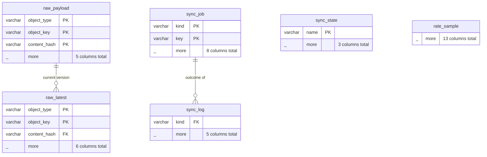

# Strava MCP Server

An MCP (Model Context Protocol) server for the [Strava API v3](https://developers.strava.com/docs/reference/), backed by a complete local mirror of the athlete's Strava data in [DuckDB](https://duckdb.org/). Exposes it through MCP tools, resources, and prompts. Built with TypeScript and the [MCP SDK](https://modelcontextprotocol.io/).

## The mirror

The server keeps everything Strava's API returns for the authenticated athlete in one DuckDB
file and answers tools from it, so most calls cost no Strava request and return in
milliseconds. A background sync fills and refreshes it within Strava's rate limits.

- **What is stored:** every activity (summary and full detail: laps, splits, best efforts,
  every segment effort), full-resolution streams, heart-rate and power zones, kudos,
  comments, photos, gear, segments and their geometry, starred segments, routes and their
  geometry, clubs, the athlete's profile and zones, and a history of the athlete's totals.
- **How:** every response is stored verbatim in `raw_payload` (a new row only when it
  changed, so it doubles as edit history) and projected into typed tables with a
  description and unit on every column (`strava_schema` lists them). Fields Strava adds
  later stay in the raw JSON and are reported by `strava_sync_status` until mapped.
- **Sync:** the first run lists every activity, then backfills newest first (detail,
  streams, zones; then social, gear, routes, segments). New activities are picked up every
  15 minutes, edits by a daily 90-day relist, deletions by a weekly full listing.
- **Rate limits:** usage is read from Strava's `X-ReadRateLimit-*` and `X-RateLimit-*`
  headers on every response. Background work may use at most 75% of each window and spreads
  it evenly over the day; incremental sync 85-90%; tool calls the rest, so a person is never
  starved. A 429 pauses everything until the window resets. Activity streams do not count
  against the limits. With Strava's default limits (100 reads per 15 minutes, 1,000 a day)
  a backfill of 2,000 activities takes about a week; the self-service upgrade in the API
  settings (200/2,000) halves that.
- **Freshness:** tools serve the stored copy when it is fresh for its kind (recent activities
  are refreshed after 15 minutes, old ones only when their summary shows a change; streams
  never change), fetch otherwise, and fall back to the stored copy, marked stale, when
  Strava cannot be asked. Each result ends with a line saying where it came from.
- **Writes** (`strava_update_activity`, `strava_create_activity`, `strava_star_segment`,
  uploads) go to Strava first; what Strava returns is stored, never an optimistic guess.
- **Other readers:** DuckDB allows one writing process, so the server publishes a consistent
  read-only copy to `snapshot/strava.duckdb` next to the mirror (hourly when it changed;
  every 6 hours during a backfill) and, with `SNAPSHOT_TOKEN` set, serves it at
  `/snapshot.duckdb`:

  ```sql
  INSTALL httpfs; LOAD httpfs;
  CREATE SECRET (TYPE http, EXTRA_HTTP_HEADERS MAP {'Authorization': 'Bearer <SNAPSHOT_TOKEN>'});
  ATTACH 'http://<host>:8000/snapshot.duckdb' AS strava (READ_ONLY);
  SELECT sport_type, count(*) FROM strava.activity GROUP BY ALL;
  ```

  Back up the snapshot, not the live file.

Strava's API Agreement (June 2026) restricts caching beyond seven days and use with AI
applications other than its own MCP. This server is meant for a single athlete's own data;
whether that use is acceptable is yours to judge.

## Tools

### The mirror
- **strava_query** - Read-only DuckDB SQL over the whole mirror (no Strava requests)
- **strava_schema** - Tables and columns, with descriptions and units
- **strava_sync_status** - Coverage, queue, recent errors, rate-limit usage, unmapped fields

### Activities
- **strava_list_activities** - List the authenticated athlete's activities with date range filtering and pagination
- **strava_get_activity** - Get detailed activity info including splits, laps, segment efforts, and gear
- **strava_create_activity** - Create a manual activity entry
- **strava_update_activity** - Update an activity's mutable properties
- **strava_list_activity_comments** - List comments on an activity
- **strava_list_activity_kudoers** - List athletes who gave kudos
- **strava_list_activity_laps** - List laps with distance, time, speed, heart rate, watts, and elevation
- **strava_list_activity_zones** - Get heart rate and power zone distribution

### Athletes
- **strava_get_authenticated_athlete** - Get the authenticated athlete's profile
- **strava_get_athlete_zones** - Get heart rate and power zones
- **strava_get_athlete_stats** - Get year-to-date and all-time totals for runs, rides, and swims

### Segments
- **strava_get_segment** - Get segment details including distance, elevation, grade, and effort count
- **strava_list_segment_efforts** - List efforts on a segment with date range filtering
- **strava_get_segment_effort** - Get a specific segment effort with achievements
- **strava_star_segment** - Star or unstar a segment

### Routes
- **strava_list_athlete_routes** - List routes created by an athlete
- **strava_get_route** - Get detailed route information
- **strava_export_route_gpx** - Export a route as GPX
- **strava_export_route_tcx** - Export a route as TCX

### Streams (Time-Series Data)
- **strava_get_activity_streams** - Get activity streams (heart rate, power, cadence, altitude, GPS, etc.)
- **strava_get_segment_effort_streams** - Get segment effort streams
- **strava_get_segment_streams** - Get segment GPS/altitude data
- **strava_get_route_streams** - Get route GPS/altitude data

### Clubs
- **strava_list_athlete_clubs** - List clubs the athlete belongs to
- **strava_get_club** - Get club details

### Gear
- **strava_get_gear** - Get equipment details (bikes, shoes)

### Uploads
- **strava_create_upload** - Upload a FIT/TCX/GPX file to create an activity
- **strava_get_upload** - Check upload processing status

## Resources

Resources provide read-only context data that clients can pull into conversations.

### Static Resources

| URI | Description |
|---|---|
| `strava://athlete/profile` | Current authenticated athlete profile (name, location, bikes, shoes) |
| `strava://athlete/stats` | Year-to-date and all-time activity totals for runs, rides, and swims |
| `strava://reference/sport-types` | Valid `sport_type` values for create/update activity |
| `strava://reference/stream-types` | Available stream keys, descriptions, and which tools accept them |

### Template Resources

| URI Template | Description |
|---|---|
| `strava://activity/{activityId}` | Detailed activity by ID |
| `strava://segment/{segmentId}` | Detailed segment by ID |
| `strava://route/{routeId}/gpx` | Export a route as GPX |

## Prompts

Prompts are user-triggered prompt templates that fetch relevant Strava data and ask the LLM for analysis.

| Prompt | Arguments | Description |
|---|---|---|
| `weekly-summary` | `week_start?` (ISO date) | Summarize training for a given week |
| `activity-analysis` | `activity_id` (required) | Deep analysis of pacing, effort, and performance for a single activity |
| `training-plan-review` | `days?` (default 30) | Review training load, volume progression, and overtraining risk |
| `segment-comparison` | `segment_id` (required) | Compare all efforts on a segment to identify trends |
| `race-readiness` | `distance?` (e.g. "marathon") | Assess fitness and race readiness based on recent training |

## Setup

### 1. Create a Strava API Application

Go to [Strava API Settings](https://www.strava.com/settings/api) and create an application. Note your Client ID and Client Secret.

### 2. Get an Access Token

You need an access token with the appropriate scopes. For read-only access use `read,activity:read_all`. For write access add `activity:write`.

You can obtain tokens through Strava's [OAuth flow](https://developers.strava.com/docs/authentication/). The server will automatically refresh expired tokens if `STRAVA_REFRESH_TOKEN`, `STRAVA_CLIENT_ID`, and `STRAVA_CLIENT_SECRET` are set.

### 3. Configure Environment Variables

```sh
export STRAVA_CLIENT_ID="your_client_id"
export STRAVA_CLIENT_SECRET="your_client_secret"
export STRAVA_ACCESS_TOKEN="your_access_token"
export STRAVA_REFRESH_TOKEN="your_refresh_token"
```

Optionally set `STRAVA_UNITS` to `metric` or `imperial` to control how distances, paces, and elevations are formatted in prompts. If unset, the server uses the athlete's Strava measurement preference, falling back to metric.

### 4. Run it as a service (Docker)

```sh
cp .env.example .env   # fill in the STRAVA_* values
docker compose up -d
```

The server speaks [Streamable HTTP](https://modelcontextprotocol.io/specification/2026-07-28)
at `http://<host>:8000/mcp` (also at `/`), with a health check at `/health`, and serves both
2026-07-28 and older session-based clients:

```json
{ "mcpServers": { "strava": { "type": "http", "url": "http://localhost:8000/mcp" } } }
```

| Variable | Default | Meaning |
|---|---|---|
| `STRAVA_CLIENT_ID`, `STRAVA_CLIENT_SECRET` | (required) | Your Strava API application |
| `STRAVA_REFRESH_TOKEN` / `STRAVA_ACCESS_TOKEN` | (one required) | OAuth tokens; access tokens are refreshed automatically |
| `STRAVA_TOKEN_FILE` | (unset; `/data/tokens.json` in compose) | Where rotated tokens are persisted, so a restart never needs a new OAuth flow |
| `STRAVA_UNITS` | athlete preference | `metric` or `imperial` |
| `MCP_TRANSPORT` | `stdio` (`http` in the image) | `stdio` or `http` |
| `PORT` | `8000` | HTTP port |
| `MCP_ALLOWED_HOSTS` | (any) | Comma-separated hostnames allowed in the `Host` header (set it behind a reverse proxy) |
| `STRAVA_DB_PATH` | `./state/strava.duckdb` (`/data/strava.duckdb` in the image) | The mirror; mount a volume |
| `STRAVA_SNAPSHOT_DIR` | `snapshot/` next to the mirror | Where read-only snapshots are published |
| `SNAPSHOT_TOKEN` | (unset: not served) | Bearer token for `GET /snapshot.duckdb` |
| `STRAVA_WEBHOOK_URL` | (unset: poll every 15 min) | Public HTTPS callback for Strava push events, with a secret path (e.g. `https://host/webhook/<random>`). The server registers the app's subscription at startup; new, edited and deleted activities are then queued within seconds, and the activity list is only polled every 6 hours as a safety net. Events only queue re-fetches from the API. HTTP transport only |
| `MCP_BEARER_TOKEN` | (unset: open) | Require this bearer token on `/mcp` (e.g. from an auth proxy) |
| `STRAVA_SYNC` | `on` | `off` serves from the mirror and fetches on demand, without background sync |
| `STRAVA_API_BASE` | `https://www.strava.com/api/v3` | Strava moves the API to `https://api-v3.strava.com` (available 2027-01-04) |
| `DUCKDB_MEMORY_LIMIT`, `DUCKDB_THREADS` | DuckDB defaults (`256MB`, `2` in the image) | Resource caps |

Images: `ghcr.io/justmytwospence/strava-mcp`, published for amd64 and arm64 by pushing a
`vX.Y.Z` tag.

### 5. Or run it over stdio (Claude Desktop)

Add to your `claude_desktop_config.json`:

```json
{
  "mcpServers": {
    "strava": {
      "command": "npx",
      "args": ["-y", "strava-mcp-server"],
      "env": {
        "STRAVA_CLIENT_ID": "your_client_id",
        "STRAVA_CLIENT_SECRET": "your_client_secret",
        "STRAVA_ACCESS_TOKEN": "your_access_token",
        "STRAVA_REFRESH_TOKEN": "your_refresh_token"
      }
    }
  }
}
```

Or if installed locally:

```json
{
  "mcpServers": {
    "strava": {
      "command": "node",
      "args": ["/path/to/strava-mcp/dist/index.js"],
      "env": {
        "STRAVA_CLIENT_ID": "your_client_id",
        "STRAVA_CLIENT_SECRET": "your_client_secret",
        "STRAVA_ACCESS_TOKEN": "your_access_token",
        "STRAVA_REFRESH_TOKEN": "your_refresh_token"
      }
    }
  }
}
```

## Development

```sh
npm install
npm run build
npm run dev    # watch mode with tsx
npm test       # rate limiter, raw splitting, and the mirror against scrubbed real payloads
```

The typed schema is declared once in `src/db/tables.ts` (columns, comments, and the JSON
each is read from); DDL, projections and the drift check are generated from it. A new
column needs a migration in `src/db/schema.ts`.

## License

MIT

## Database schema

Entity-relationship diagrams of the DuckDB mirror. Each table shows its primary-key and join columns plus its total column count; joins are logical (DuckDB foreign keys are not declared). Full column comments: the `strava_schema` tool or `DESCRIBE` on the snapshot.

### domain

```mermaid
erDiagram
  activity {
    bigint id PK
    bigint athlete_id FK
    varchar gear_id FK
    _ more "76 columns total"
  }
  activity_best_effort {
    bigint id PK
    bigint activity_id FK
    bigint athlete_id FK
    _ more "14 columns total"
  }
  activity_comment {
    bigint id PK
    bigint activity_id FK
    _ more "11 columns total"
  }
  activity_kudoer {
    bigint activity_id PK,FK
    integer idx PK
    _ more "5 columns total"
  }
  activity_lap {
    bigint id PK
    bigint activity_id FK
    _ more "23 columns total"
  }
  activity_photo {
    varchar unique_id PK
    bigint activity_id FK
    _ more "18 columns total"
  }
  activity_segment_effort {
    bigint id PK
    bigint activity_id FK
    bigint segment_id FK
    _ more "25 columns total"
  }
  activity_split {
    bigint activity_id PK,FK
    varchar units PK
    integer split PK
    _ more "12 columns total"
  }
  activity_stream_meta {
    bigint activity_id PK,FK
    varchar stream_type PK
    _ more "6 columns total"
  }
  activity_stream_point {
    bigint activity_id PK,FK
    integer idx PK
    _ more "14 columns total"
  }
  activity_zone {
    bigint activity_id PK,FK
    varchar type PK
    _ more "9 columns total"
  }
  activity_zone_bucket {
    bigint activity_id PK,FK
    varchar type PK
    integer bucket_index PK
    _ more "7 columns total"
  }
  athlete {
    bigint id PK
    _ more "30 columns total"
  }
  athlete_stats {
    timestamptz fetched_at PK
    varchar period PK
    varchar sport PK
    _ more "11 columns total"
  }
  athlete_zone {
    varchar kind PK
    integer zone_index PK
    _ more "6 columns total"
  }
  club {
    bigint id PK
    _ more "28 columns total"
  }
  duckdb_columns {
    _ more "18 columns total"
  }
  duckdb_constraints {
    _ more "15 columns total"
  }
  duckdb_databases {
    _ more "11 columns total"
  }
  duckdb_indexes {
    _ more "14 columns total"
  }
  duckdb_logs {
    _ more "10 columns total"
  }
  duckdb_schemas {
    _ more "8 columns total"
  }
  duckdb_tables {
    _ more "16 columns total"
  }
  duckdb_types {
    _ more "13 columns total"
  }
  duckdb_views {
    _ more "13 columns total"
  }
  gear {
    varchar id PK
    _ more "16 columns total"
  }
  pragma_database_list {
    _ more "3 columns total"
  }
  route {
    bigint id PK
    bigint athlete_id FK
    _ more "22 columns total"
  }
  route_point {
    bigint route_id PK,FK
    integer idx PK
    _ more "6 columns total"
  }
  segment {
    bigint id PK
    _ more "34 columns total"
  }
  segment_effort_stream_point {
    bigint effort_id PK,FK
    integer idx PK
    _ more "14 columns total"
  }
  segment_stream_point {
    bigint segment_id PK,FK
    integer idx PK
    _ more "6 columns total"
  }
  sqlite_master {
    _ more "5 columns total"
  }
  sqlite_schema {
    _ more "5 columns total"
  }
  sqlite_temp_master {
    _ more "5 columns total"
  }
  sqlite_temp_schema {
    _ more "5 columns total"
  }
  activity ||--o{ activity_best_effort : "activity_id"
  activity ||--o{ activity_comment : "activity_id"
  activity ||--o{ activity_kudoer : "activity_id"
  activity ||--o{ activity_lap : "activity_id"
  activity ||--o{ activity_photo : "activity_id"
  activity ||--o{ activity_segment_effort : "activity_id"
  activity ||--o{ activity_split : "activity_id"
  activity ||--o{ activity_stream_meta : "activity_id"
  activity ||--o{ activity_stream_point : "activity_id"
  activity ||--o{ activity_zone : "activity_id"
  athlete ||--o{ activity : "athlete_id"
  gear ||--o{ activity : "gear_id"
  segment ||--o{ activity_segment_effort : "segment_id"
  segment ||--o{ segment_stream_point : "segment_id"
  activity_segment_effort ||--o{ segment_effort_stream_point : "effort_id"
  route ||--o{ route_point : "route_id"
  athlete ||--o{ route : "athlete_id"
  athlete ||--o{ activity_best_effort : "athlete_id"
  activity_zone ||--o{ activity_zone_bucket : "activity_id"
```



### raw store and sync


