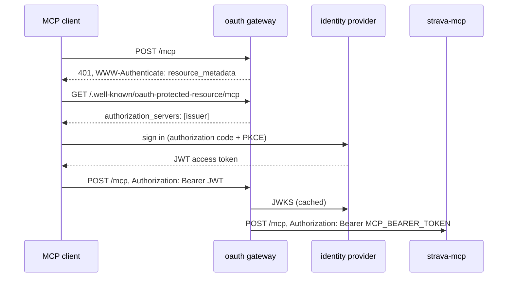

# Authentication

Three separate things need credentials: the server's access to Strava, your clients' access to the server, and, optionally, signing in with your own identity provider instead of a shared token.

## The server's access to Strava

Strava authorizes an API application for one athlete through OAuth. The server needs the resulting refresh token, and it needs to keep it, because Strava may rotate the refresh token on any refresh: a token kept only in an environment variable dies after the first rotation and a restart.

`strava-mcp auth` runs the authorization once and writes the pair to `STRAVA_TOKEN_FILE` (`/data/tokens.json` in the image, inside the data volume):

```sh
docker compose run --rm -p 8765:8765 strava-mcp auth
```

```text
Open this URL in a browser and allow access:

  https://www.strava.com/oauth/authorize?client_id=...&redirect_uri=http%3A%2F%2Flocalhost%3A8765%2Fcallback&scope=read%2Cactivity%3Aread_all%2Cactivity%3Awrite%2Cprofile%3Aread_all&...

Waiting for Strava's redirect on http://localhost:8765/callback. If the browser cannot reach this machine
(the page fails to load), paste the URL from its address bar here instead:
```

It requests the scopes `read,activity:read_all,activity:write,profile:read_all`. Strava only redirects to the application's **Authorization Callback Domain**, so set that to `localhost` in the API settings. Options:

| Option | Meaning |
|---|---|
| `--port N` | Listen on another port (and publish it: `-p N:N`). Also `STRAVA_AUTH_PORT`. |
| `--no-listen` | Do not listen; only accept the redirected URL or code pasted on stdin. For headless servers. |
| `--scopes a,b` | Request other scopes. |
| `--token-file PATH` | Write elsewhere than `STRAVA_TOKEN_FILE`. |

The same command is `strava-mcp-auth` when the npm package is installed, and the server exits at startup with a pointer to it when it finds no refresh token anywhere.

The token file is JSON with `access_token`, `refresh_token`, `expires_at`, and informational `scope` and `athlete_id`. It is written atomically with mode 0600. Back it up; with it and nothing else the server rebuilds the mirror from Strava. To revoke access, remove the application at [strava.com/settings/apps](https://www.strava.com/settings/apps).

## Clients: the bearer token

`MCP_BEARER_TOKEN` is a shared secret every client must send as `Authorization: Bearer <token>` on `/mcp`. Without it, the endpoint answers `401`. Compose requires it, because the server is otherwise open to everyone who can reach the port.

Generate one with `openssl rand -hex 32`. [Clients](clients.md) shows where each client puts it. If the server shares a network with things that should only read the snapshot, give those `SNAPSHOT_TOKEN` and keep the bearer to yourself: the two tokens open different endpoints.

## OAuth 2.1 with your identity provider

The `oauth` profile puts [agentgateway](https://agentgateway.dev/) in front of `/mcp` as an OAuth 2.1 resource server. Clients that support MCP authorization (claude.ai, Claude Code, Claude Desktop, Cursor, pi) then sign in through your identity provider, and the gateway forwards their requests to the server with the bearer token. Nothing but the gateway needs the token.



The gateway verifies the token's signature against `OIDC_JWKS_URL`, its issuer against `OIDC_ISSUER`, and its audience against `OIDC_AUDIENCE` (the client id by default). You put your own TLS reverse proxy in front of the gateway's port at `PUBLIC_URL`; the gateway does not terminate TLS. The server's own port can then stay unpublished: remove the `ports` entry of `strava-mcp` in a Compose override.

```ini
OIDC_ISSUER=https://auth.example.com
OIDC_JWKS_URL=https://auth.example.com/jwks.json
OIDC_CLIENT_ID=strava-mcp
PUBLIC_URL=https://strava.example.com
```

```sh
docker compose --profile oauth up -d
curl -s https://strava.example.com/.well-known/oauth-protected-resource/mcp
```

The last command must return JSON naming your issuer in `authorization_servers`; a request to `https://strava.example.com/mcp` without a token must return `401`.

### What to register at the provider

Register a client for this server with:

- **Redirect URIs**: `https://claude.ai/api/mcp/auth_callback` for claude.ai, Claude Desktop and the mobile apps, and a loopback redirect for Claude Code and other local clients: `http://localhost:<port>/callback`. Claude Code picks an ephemeral port per session; if your provider cannot match a redirect URI regardless of port, pin it with `claude mcp add ... --callback-port 3118` (or `oauth.callbackPort` in pi's `mcp.json`) and register `http://localhost:3118/callback`.
- **Grant types**: authorization code with PKCE (S256) and refresh token.
- **Scopes**: `openid`, `profile`, `offline_access`. These are what the gateway advertises in `scopes_supported` and what clients request.
- **Public client** (no secret) is the usual choice: Claude Code and claude.ai's custom connectors register as public clients. Providers with dynamic client registration let clients register themselves instead; the Claude apps use it when the provider advertises a `registration_endpoint`.
- **Access tokens as JWTs** whose `aud` contains the client id. If your provider puts something else in `aud`, set `OIDC_AUDIENCE` to it.

In claude.ai, add the server as a custom connector with the URL `PUBLIC_URL/mcp`; when the provider has no dynamic registration, enter the client id in the connector's advanced settings. In Claude Code, `claude mcp add --transport http strava https://strava.example.com/mcp` and then `/mcp` to sign in.

### Providers

=== "Authelia"

    Issuer `https://auth.example.com`, JWKS `https://auth.example.com/jwks.json` (the default). Add the client to `identity_providers.oidc.clients` with `public: true`, `redirect_uris`, `scopes: [openid, profile, offline_access]`, `grant_types: [authorization_code, refresh_token]`, `pkce_challenge_method: S256`, and `access_token_signed_response_alg: RS256`, so that access tokens are JWTs the gateway can verify (Authelia issues opaque tokens otherwise). Authelia has no dynamic registration and matches redirect URIs exactly: pin Claude Code's port.

=== "Authentik"

    Create an OAuth2/OpenID provider and an application. The issuer is the provider's URL, `https://auth.example.com/application/o/<slug>/`, and the JWKS endpoint `https://auth.example.com/application/o/<slug>/jwks/`: set `OIDC_JWKS_URL`. Client type public, signing key set, redirect URIs may be regular expressions (`^http://localhost:\d+/callback$` covers Claude Code). Access tokens are JWTs with the client id in `aud`.

=== "Keycloak"

    Issuer `https://keycloak.example.com/realms/<realm>`, JWKS `.../realms/<realm>/protocol/openid-connect/certs`: set `OIDC_JWKS_URL`. Create a public client with standard flow, PKCE S256, and the redirect URIs. Keycloak's access tokens carry `account` in `aud` unless the client has an audience mapper: add one (Client scopes, the client's dedicated scope, Add mapper, Audience) with the client id as the included client audience, or set `OIDC_AUDIENCE=account`. Keycloak can also offer dynamic registration through its client registration policies.

=== "Pocket ID"

    Issuer is the base URL `https://id.example.com`, JWKS `https://id.example.com/.well-known/jwks.json`: set `OIDC_JWKS_URL`. Create an OIDC client marked public with the callback URLs; access tokens are JWTs with the client id in `aud`.

=== "Others"

    Any provider that issues JWT access tokens over OpenID Connect works. Find the issuer and JWKS URL in `https://<issuer>/.well-known/openid-configuration` (`issuer`, `jwks_uri`), and check a token's `aud` claim to set `OIDC_AUDIENCE`. The gateway's own documentation covers presets for Auth0, Okta, Entra and Descope.

### Keeping the webhook reachable

The Strava webhook path (`STRAVA_WEBHOOK_URL`) must stay public and unauthenticated; it is protected by its secret path, and events only queue re-fetches. When the gateway is in front, route the webhook path at the reverse proxy to the server directly (port 8000), not through the gateway. [How sync works](sync.md#webhook) has the recipes.
