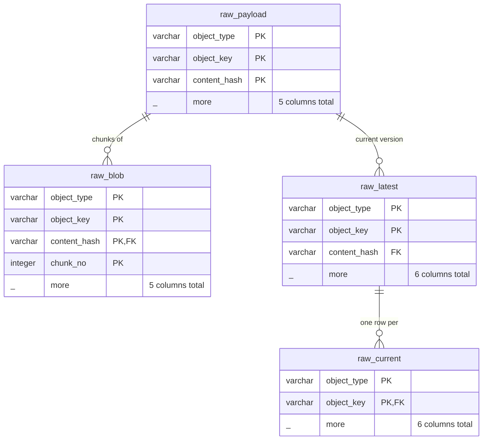
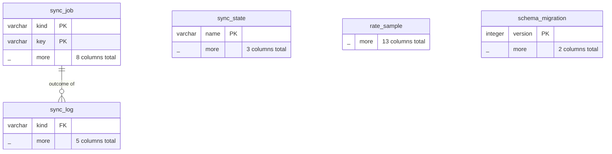

# Schema reference

<!-- Generated by scripts/gen-schema.ts from the DuckDB catalog of a migrated empty mirror; do not edit by hand. -->

The mirror has 30 tables and 1 view. The typed tables are declared once in `src/db/tables.ts` (columns, comments and the JSON each column is read from); the raw store and the sync bookkeeping are declared in `src/db/schema.ts`. The same comments are available inside the database (`strava_schema`, or `duckdb_columns()` on the snapshot).

Units follow Strava: meters, seconds, meters per second, degrees Celsius, watts, beats per minute. Timestamps are UTC (`TIMESTAMP WITH TIME ZONE`) except the `*_local` wall-clock columns.

## Entity-relationship diagrams

Each entity lists its key and join columns and its total column count. Keys and joins are logical: DuckDB enforces a primary key only on the small tables, and no foreign keys are declared.

### Activities, athlete, gear, segments, routes, clubs

```mermaid
erDiagram
  activity {
    bigint id PK
    bigint athlete_id FK
    varchar gear_id FK
    _ more "76 columns total"
  }
  activity_best_effort {
    bigint id PK
    bigint activity_id FK
    bigint athlete_id FK
    _ more "14 columns total"
  }
  activity_comment {
    bigint id PK
    bigint activity_id FK
    _ more "11 columns total"
  }
  activity_kudoer {
    bigint activity_id PK,FK
    integer idx PK
    _ more "5 columns total"
  }
  activity_lap {
    bigint id PK
    bigint activity_id FK
    _ more "23 columns total"
  }
  activity_photo {
    varchar unique_id PK
    bigint activity_id FK
    _ more "18 columns total"
  }
  activity_segment_effort {
    bigint id PK
    bigint activity_id FK
    bigint segment_id FK
    _ more "25 columns total"
  }
  activity_split {
    bigint activity_id PK,FK
    varchar units PK
    integer split PK
    _ more "12 columns total"
  }
  activity_stream_meta {
    bigint activity_id PK,FK
    varchar stream_type PK
    _ more "6 columns total"
  }
  activity_stream_point {
    bigint activity_id PK,FK
    integer idx PK
    _ more "14 columns total"
  }
  activity_zone {
    bigint activity_id PK,FK
    varchar type PK
    _ more "9 columns total"
  }
  activity_zone_bucket {
    bigint activity_id PK,FK
    varchar type PK
    integer bucket_index PK
    _ more "7 columns total"
  }
  athlete {
    bigint id PK
    _ more "30 columns total"
  }
  athlete_stats {
    timestamptz fetched_at PK
    varchar period PK
    varchar sport PK
    _ more "11 columns total"
  }
  athlete_zone {
    varchar kind PK
    integer zone_index PK
    _ more "6 columns total"
  }
  club {
    bigint id PK
    _ more "28 columns total"
  }
  gear {
    varchar id PK
    _ more "16 columns total"
  }
  route {
    bigint id PK
    bigint athlete_id FK
    _ more "22 columns total"
  }
  route_point {
    bigint route_id PK,FK
    integer idx PK
    _ more "6 columns total"
  }
  segment {
    bigint id PK
    _ more "34 columns total"
  }
  segment_effort_stream_point {
    bigint effort_id PK,FK
    integer idx PK
    _ more "14 columns total"
  }
  segment_stream_point {
    bigint segment_id PK,FK
    integer idx PK
    _ more "6 columns total"
  }
  activity ||--o{ activity_best_effort : "activity_id"
  activity ||--o{ activity_comment : "activity_id"
  activity ||--o{ activity_kudoer : "activity_id"
  activity ||--o{ activity_lap : "activity_id"
  activity ||--o{ activity_photo : "activity_id"
  activity ||--o{ activity_segment_effort : "activity_id"
  activity ||--o{ activity_split : "activity_id"
  activity ||--o{ activity_stream_meta : "activity_id"
  activity ||--o{ activity_stream_point : "activity_id"
  activity ||--o{ activity_zone : "activity_id"
  athlete ||--o{ activity : "athlete_id"
  gear ||--o{ activity : "gear_id"
  segment ||--o{ activity_segment_effort : "segment_id"
  segment ||--o{ segment_stream_point : "segment_id"
  activity_segment_effort ||--o{ segment_effort_stream_point : "effort_id"
  route ||--o{ route_point : "route_id"
  athlete ||--o{ route : "athlete_id"
  athlete ||--o{ activity_best_effort : "athlete_id"
  activity_zone ||--o{ activity_zone_bucket : "activity_id"
```

### Raw store

### Sync bookkeeping

## Tables

### activity

One row per Strava activity of the athlete. Summary columns come from the newest of the list or detail payload; detail-only columns are null until the detail is fetched. Deleted activities are kept with deleted_at set.

Key: `id`

| Column | Type | Description |
|---|---|---|
| `id` | BIGINT | Strava activity id. |
| `athlete_id` | BIGINT | Owning athlete id. |
| `name` | VARCHAR | Activity title. |
| `sport_type` | VARCHAR | Sport type (Run, Ride, TrailRun, ...); the precise successor of `type`. |
| `type` | VARCHAR | Legacy activity type (deprecated by Strava in favor of sport_type). |
| `workout_type` | INTEGER | Workout tag: run 0 default, 1 race, 2 long run, 3 workout; ride 10 default, 11 race, 12 workout. |
| `start_date` | TIMESTAMP WITH TIME ZONE | Start time (UTC). |
| `start_date_local` | TIMESTAMP | Start time in the activity's local time zone (wall clock). |
| `timezone` | VARCHAR | Strava time zone label, e.g. '(GMT-07:00) America/Denver'. |
| `utc_offset` | DOUBLE | Offset of local time from UTC at the start, in seconds. |
| `distance` | DOUBLE | Distance in meters. |
| `moving_time` | INTEGER | Moving time in seconds. |
| `elapsed_time` | INTEGER | Elapsed time in seconds. |
| `total_elevation_gain` | DOUBLE | Elevation gain in meters. |
| `elev_high` | DOUBLE | Highest elevation in meters. |
| `elev_low` | DOUBLE | Lowest elevation in meters. |
| `average_speed` | DOUBLE | Average speed in meters per second. |
| `max_speed` | DOUBLE | Maximum speed in meters per second. |
| `average_cadence` | DOUBLE | Average cadence (rpm; for runs Strava reports one-leg steps per minute). |
| `average_temp` | DOUBLE | Average temperature in degrees Celsius (device sensor). |
| `average_watts` | DOUBLE | Average power in watts (estimated when device_watts is false). |
| `weighted_average_watts` | DOUBLE | Strava's weighted (normalized-power-like) average power in watts. |
| `max_watts` | DOUBLE | Maximum power in watts (power meter only). |
| `kilojoules` | DOUBLE | Work done in kilojoules (rides). |
| `device_watts` | BOOLEAN | True when power came from a power meter rather than Strava's estimate. |
| `has_heartrate` | BOOLEAN | Whether heart rate was recorded. |
| `average_heartrate` | DOUBLE | Average heart rate in bpm. |
| `max_heartrate` | DOUBLE | Maximum heart rate in bpm. |
| `heartrate_opt_out` | BOOLEAN | Athlete hid heart rate on this activity. |
| `display_hide_heartrate_option` | BOOLEAN | Whether Strava offers the hide-heart-rate option. |
| `suffer_score` | DOUBLE | Relative Effort score. |
| `achievement_count` | INTEGER | Number of achievements (PRs, KOMs, ...). |
| `pr_count` | INTEGER | Number of personal records set. |
| `kudos_count` | INTEGER | Number of kudos. |
| `comment_count` | INTEGER | Number of comments. |
| `athlete_count` | INTEGER | Number of athletes who did this activity together (group size). |
| `photo_count` | INTEGER | Number of Instagram photos (legacy). |
| `total_photo_count` | INTEGER | Number of photos, all sources. |
| `trainer` | BOOLEAN | Recorded on a trainer / indoors. |
| `commute` | BOOLEAN | Marked as a commute. |
| `manual` | BOOLEAN | Entered manually (no file, no streams). |
| `private` | BOOLEAN | Private activity (legacy flag; see visibility). |
| `visibility` | VARCHAR | everyone, followers_only or only_me. |
| `flagged` | BOOLEAN | Flagged by Strava or other athletes. |
| `from_accepted_tag` | BOOLEAN | Created by accepting a group activity tag. |
| `has_kudoed` | BOOLEAN | Whether the authenticated athlete kudoed it. |
| `gear_id` | VARCHAR | Gear used (references gear.id). |
| `device_name` | VARCHAR | Recording device, e.g. 'Garmin Fenix 7'. |
| `external_id` | VARCHAR | Identifier from the upload source (Garmin: garmin_ping_<id>, not the Garmin activity id). |
| `upload_id` | BIGINT | Upload id (the bulk export names original files by it). |
| `upload_id_str` | VARCHAR | Upload id as a string. |
| `start_latlng` | DOUBLE[] | Start [lat, lng]. |
| `end_latlng` | DOUBLE[] | End [lat, lng]. |
| `location_city` | VARCHAR | City (often null). |
| `location_state` | VARCHAR | State (often null). |
| `location_country` | VARCHAR | Country (often null). |
| `map_id` | VARCHAR | Map id. |
| `summary_polyline` | VARCHAR | Google-encoded summary polyline. |
| `tags` | JSON | Activity tags (WithPet, Recovery, Competition, ForACause, Commute). |
| `description` | VARCHAR | Activity description. |
| `private_note` | VARCHAR | Private note visible only to the athlete. |
| `calories` | DOUBLE | Calories (kilocalories) as Strava computes them. |
| `perceived_exertion` | DOUBLE | Perceived exertion (1-10) if entered. |
| `prefer_perceived_exertion` | BOOLEAN | Use perceived exertion instead of heart rate for Relative Effort. |
| `hide_from_home` | BOOLEAN | Muted from home feeds. |
| `embed_token` | VARCHAR | Token for embedding the activity. |
| `polyline` | VARCHAR | Google-encoded full-resolution polyline. |
| `available_zones` | VARCHAR[] | Zone types available for this activity (heartrate, power, pace). |
| `stats_visibility` | JSON | Per-stat visibility settings. |
| `similar_activities` | JSON | Strava's comparison with similar efforts (trend of speeds, PR rank). |
| `sport_image_visibility` | VARCHAR | Visibility of the sport image. |
| `photos_summary` | JSON | Primary photo and photo count as shown on the activity. |
| `gear_summary` | JSON | Gear as embedded in the activity (name, distance at fetch time). |
| `summary_fetched_at` | TIMESTAMP WITH TIME ZONE | When the newest list (summary) payload was fetched. |
| `detail_fetched_at` | TIMESTAMP WITH TIME ZONE | When the detail payload was fetched; null if never. |
| `deleted_at` | TIMESTAMP WITH TIME ZONE | When the activity was found deleted on Strava; null while it exists. |

### activity_best_effort

Strava's best efforts within an activity (fastest 400m, 1k, mile, 5k, ... for runs).

Key: `id`

| Column | Type | Description |
|---|---|---|
| `id` | BIGINT | Best effort id. |
| `activity_id` | BIGINT | Activity id. |
| `athlete_id` | BIGINT | Athlete id. |
| `name` | VARCHAR | Effort name, e.g. '5k', '1 mile', 'Half-Marathon'. |
| `distance` | DOUBLE | Target distance in meters. |
| `elapsed_time` | INTEGER | Elapsed time in seconds. |
| `moving_time` | INTEGER | Moving time in seconds. |
| `start_date` | TIMESTAMP WITH TIME ZONE | Start (UTC). |
| `start_date_local` | TIMESTAMP | Start, local wall clock. |
| `start_index` | INTEGER | Stream index of the start. |
| `end_index` | INTEGER | Stream index of the end. |
| `pr_rank` | INTEGER | 1-3 when this was a top-3 personal best at the time. |
| `achievements` | JSON | Achievements earned. |
| `fetched_at` | TIMESTAMP WITH TIME ZONE | When this row's source payload was fetched from Strava. |

### activity_comment

Comments on activities.

Key: `id`

| Column | Type | Description |
|---|---|---|
| `id` | BIGINT | Comment id. |
| `activity_id` | BIGINT | Activity id. |
| `text` | VARCHAR | Comment text. |
| `created_at` | TIMESTAMP WITH TIME ZONE | When the comment was posted. |
| `athlete_firstname` | VARCHAR | Commenter first name. |
| `athlete_lastname` | VARCHAR | Commenter last name/initial. |
| `reaction_count` | INTEGER | Number of reactions. |
| `has_reacted` | BOOLEAN | Whether the athlete reacted. |
| `mentions_metadata` | JSON | Mentions in the text. |
| `post_id` | BIGINT | Post id (null for activity comments). |
| `fetched_at` | TIMESTAMP WITH TIME ZONE | When this row's source payload was fetched from Strava. |

### activity_kudoer

Athletes who gave kudos (Strava exposes only first name and last initial).

Key: `activity_id`, `idx`

| Column | Type | Description |
|---|---|---|
| `activity_id` | BIGINT | Activity id. |
| `idx` | INTEGER | Position in Strava's kudos list. |
| `firstname` | VARCHAR | Kudoer first name. |
| `lastname` | VARCHAR | Kudoer last initial. |
| `fetched_at` | TIMESTAMP WITH TIME ZONE | When this row's source payload was fetched from Strava. |

### activity_lap

Laps of each activity, from the activity detail.

Key: `id`

| Column | Type | Description |
|---|---|---|
| `id` | BIGINT | Lap id. |
| `activity_id` | BIGINT | Activity id. |
| `athlete_id` | BIGINT | Athlete id. |
| `lap_index` | INTEGER | 1-based lap number. |
| `split` | INTEGER | Split number. |
| `name` | VARCHAR | Lap name. |
| `start_date` | TIMESTAMP WITH TIME ZONE | Lap start (UTC). |
| `start_date_local` | TIMESTAMP | Lap start, local wall clock. |
| `elapsed_time` | INTEGER | Elapsed time in seconds. |
| `moving_time` | INTEGER | Moving time in seconds. |
| `distance` | DOUBLE | Distance in meters. |
| `start_index` | INTEGER | Stream index of the start. |
| `end_index` | INTEGER | Stream index of the end. |
| `total_elevation_gain` | DOUBLE | Elevation gain in meters. |
| `average_speed` | DOUBLE | Average speed in m/s. |
| `max_speed` | DOUBLE | Max speed in m/s. |
| `average_cadence` | DOUBLE | Average cadence. |
| `average_watts` | DOUBLE | Average power in watts. |
| `device_watts` | BOOLEAN | Power from a power meter. |
| `average_heartrate` | DOUBLE | Average heart rate in bpm. |
| `max_heartrate` | DOUBLE | Max heart rate in bpm. |
| `pace_zone` | INTEGER | Pace zone of the lap (runs). |
| `fetched_at` | TIMESTAMP WITH TIME ZONE | When this row's source payload was fetched from Strava. |

### activity_photo

Photos and videos attached to activities (undocumented photos endpoint, full-size URLs).

Key: `unique_id`

| Column | Type | Description |
|---|---|---|
| `unique_id` | VARCHAR | Photo id. |
| `activity_id` | BIGINT | Activity id. |
| `caption` | VARCHAR | Caption. |
| `type` | INTEGER | Photo type. |
| `source` | INTEGER | 1 Strava, 2 Instagram. |
| `status` | INTEGER | Processing status. |
| `media_type` | INTEGER | 1 photo, 2 video. |
| `uploaded_at` | TIMESTAMP WITH TIME ZONE | Upload time. |
| `created_at` | TIMESTAMP WITH TIME ZONE | Capture time (UTC). |
| `created_at_local` | TIMESTAMP | Capture time, local wall clock. |
| `urls` | JSON | CDN URLs by size (the 5000 size is full resolution). |
| `sizes` | JSON | Pixel dimensions by size. |
| `location` | DOUBLE[] | [lat, lng] where taken. |
| `default_photo` | BOOLEAN | The activity's cover photo. |
| `is_strava_strength` | BOOLEAN | Strength-training media. |
| `video_url` | VARCHAR | Video URL for videos. |
| `duration` | DOUBLE | Video duration in seconds. |
| `fetched_at` | TIMESTAMP WITH TIME ZONE | When this row's source payload was fetched from Strava. |

### activity_segment_effort

Segment efforts: every effort embedded in activity details (include_all_efforts), plus efforts fetched through segment effort lists. Join segment for the segment's attributes.

Key: `id`

| Column | Type | Description |
|---|---|---|
| `id` | BIGINT | Segment effort id. |
| `activity_id` | BIGINT | Activity the effort belongs to. |
| `segment_id` | BIGINT | Segment ridden or run. |
| `athlete_id` | BIGINT | Athlete id. |
| `name` | VARCHAR | Segment name at the time of the effort. |
| `start_date` | TIMESTAMP WITH TIME ZONE | Effort start (UTC). |
| `start_date_local` | TIMESTAMP | Effort start, local wall clock. |
| `elapsed_time` | INTEGER | Elapsed time in seconds. |
| `moving_time` | INTEGER | Moving time in seconds. |
| `distance` | DOUBLE | Distance in meters. |
| `start_index` | INTEGER | Index into the activity's streams where the effort starts. |
| `end_index` | INTEGER | Index into the activity's streams where the effort ends. |
| `average_cadence` | DOUBLE | Average cadence. |
| `average_watts` | DOUBLE | Average power in watts. |
| `device_watts` | BOOLEAN | Power from a power meter. |
| `average_heartrate` | DOUBLE | Average heart rate in bpm. |
| `max_heartrate` | DOUBLE | Maximum heart rate in bpm. |
| `pr_rank` | INTEGER | 1-3 when this effort was the athlete's 1st-3rd best at the time; null otherwise. |
| `kom_rank` | INTEGER | 1-10 when this effort placed in the overall top 10 at the time; null otherwise. |
| `achievements` | JSON | Achievements earned ([{type_id, type, rank}]). |
| `visibility` | VARCHAR | Effort visibility. |
| `hidden` | BOOLEAN | Hidden effort (e.g. auto-hidden for being implausible). |
| `is_kom` | BOOLEAN | Whether this effort is the current KOM/QOM (segment effort lists only). |
| `athlete_segment_stats` | JSON | Athlete's PR and effort count on the segment (single-effort fetches only). |
| `fetched_at` | TIMESTAMP WITH TIME ZONE | When this row's source payload was fetched from Strava. |

### activity_split

Per-kilometer (metric) and per-mile (standard) splits of each activity, from the activity detail.

Key: `activity_id`, `units`, `split`

| Column | Type | Description |
|---|---|---|
| `activity_id` | BIGINT | Activity id. |
| `units` | VARCHAR | 'metric' (1 km splits) or 'standard' (1 mile splits). |
| `split` | INTEGER | 1-based split number. |
| `distance` | DOUBLE | Distance in meters (the last split is usually partial). |
| `elapsed_time` | INTEGER | Elapsed time in seconds. |
| `moving_time` | INTEGER | Moving time in seconds. |
| `elevation_difference` | DOUBLE | Net elevation change in meters. |
| `average_speed` | DOUBLE | Average speed in m/s. |
| `average_grade_adjusted_speed` | DOUBLE | Grade-adjusted average speed in m/s. |
| `average_heartrate` | DOUBLE | Average heart rate in bpm. |
| `pace_zone` | INTEGER | Pace zone. |
| `fetched_at` | TIMESTAMP WITH TIME ZONE | When this row's source payload was fetched from Strava. |

### activity_stream_meta

Per-activity stream metadata; one row per stream type present.

Key: `activity_id`, `stream_type`

| Column | Type | Description |
|---|---|---|
| `activity_id` | BIGINT | Activity id. |
| `stream_type` | VARCHAR | Stream key: time, distance, latlng, altitude, velocity_smooth, heartrate, cadence, watts, temp, moving, grade_smooth. |
| `original_size` | INTEGER | Number of points Strava holds for the stream. |
| `resolution` | VARCHAR | Resolution label Strava reports (high = full). |
| `series_type` | VARCHAR | What the stream is indexed by (time or distance). |
| `fetched_at` | TIMESTAMP WITH TIME ZONE | When this row's source payload was fetched from Strava. |

### activity_stream_point

Full-resolution activity streams in long form: one row per recorded point, one column per channel (null when the channel was not recorded). Rows are unique by (activity_id, idx).

Key: `activity_id`, `idx`

| Column | Type | Description |
|---|---|---|
| `activity_id` | BIGINT | Owning activity id. |
| `idx` | INTEGER | 0-based point index (start_index/end_index of laps and efforts refer to it). |
| `time` | INTEGER | Seconds since the activity start. |
| `distance` | DOUBLE | Cumulative distance in meters. |
| `lat` | DOUBLE | Latitude (from the latlng stream). |
| `lng` | DOUBLE | Longitude (from the latlng stream). |
| `altitude` | DOUBLE | Altitude in meters. |
| `velocity_smooth` | DOUBLE | Smoothed speed in m/s. |
| `heartrate` | INTEGER | Heart rate in bpm. |
| `cadence` | INTEGER | Cadence (rpm; runs: one-leg steps per minute). |
| `watts` | INTEGER | Power in watts. |
| `temp` | INTEGER | Temperature in degrees Celsius. |
| `moving` | BOOLEAN | Whether the athlete was moving. |
| `grade_smooth` | DOUBLE | Smoothed grade in percent. |

### activity_zone

Heart-rate and power zone summaries per activity (GET /activities/{id}/zones).

Key: `activity_id`, `type`

| Column | Type | Description |
|---|---|---|
| `activity_id` | BIGINT | Activity id. |
| `type` | VARCHAR | heartrate or power. |
| `score` | DOUBLE | Strava's zone score for the activity. |
| `points` | INTEGER | Zone points. |
| `sensor_based` | BOOLEAN | Computed from sensor data. |
| `custom_zones` | BOOLEAN | Athlete uses custom zones. |
| `max` | INTEGER | Max value for the zone distribution. |
| `distribution_buckets` | JSON | Raw buckets; also unnested into activity_zone_bucket. |
| `fetched_at` | TIMESTAMP WITH TIME ZONE | When this row's source payload was fetched from Strava. |

### activity_zone_bucket

Time in each heart-rate or power zone per activity.

Key: `activity_id`, `type`, `bucket_index`

| Column | Type | Description |
|---|---|---|
| `activity_id` | BIGINT | Activity id. |
| `type` | VARCHAR | heartrate or power. |
| `bucket_index` | INTEGER | 0-based zone index. |
| `min` | DOUBLE | Lower bound (bpm or watts). |
| `max` | DOUBLE | Upper bound (bpm or watts); -1 means unbounded. |
| `time` | DOUBLE | Seconds spent in the zone. |
| `fetched_at` | TIMESTAMP WITH TIME ZONE | When this row's source payload was fetched from Strava. |

### athlete

The authenticated athlete's profile.

Key: `id`

| Column | Type | Description |
|---|---|---|
| `id` | BIGINT | Athlete id. |
| `username` | VARCHAR | Username. |
| `firstname` | VARCHAR | First name. |
| `lastname` | VARCHAR | Last name. |
| `bio` | VARCHAR | Profile bio. |
| `city` | VARCHAR | City. |
| `state` | VARCHAR | State. |
| `country` | VARCHAR | Country. |
| `sex` | VARCHAR | M or F. |
| `premium` | BOOLEAN | Subscriber (legacy flag). |
| `summit` | BOOLEAN | Subscriber. |
| `created_at` | TIMESTAMP WITH TIME ZONE | Account creation. |
| `updated_at` | TIMESTAMP WITH TIME ZONE | Profile last updated. |
| `badge_type_id` | INTEGER | Badge type. |
| `weight` | DOUBLE | Weight in kilograms. |
| `ftp` | INTEGER | Functional threshold power in watts. |
| `profile_medium` | VARCHAR | Avatar URL (medium). |
| `profile` | VARCHAR | Avatar URL (large). |
| `follower_count` | INTEGER | Followers. |
| `friend_count` | INTEGER | Athletes followed. |
| `mutual_friend_count` | INTEGER | Mutual follows. |
| `athlete_type` | INTEGER | 0 cyclist, 1 runner. |
| `date_preference` | VARCHAR | Date format preference. |
| `measurement_preference` | VARCHAR | feet (imperial) or meters (metric). |
| `postable_clubs_count` | INTEGER | Clubs the athlete may post in. |
| `blocked` | BOOLEAN | Blocked flag (relationship to self). |
| `can_follow` | BOOLEAN | Follow flag (relationship to self). |
| `friend` | VARCHAR | Relationship to self (null). |
| `follower` | VARCHAR | Relationship to self (null). |
| `fetched_at` | TIMESTAMP WITH TIME ZONE | When this row's source payload was fetched from Strava. |

### athlete_stats

History of the athlete's totals (recent = last 4 weeks, ytd, all) by sport. A row set is appended whenever Strava's numbers change.

Key: `fetched_at`, `period`, `sport`

| Column | Type | Description |
|---|---|---|
| `fetched_at` | TIMESTAMP WITH TIME ZONE | When this row's source payload was fetched from Strava. |
| `period` | VARCHAR | recent (last 4 weeks), ytd or all. |
| `sport` | VARCHAR | ride, run or swim. |
| `count` | INTEGER | Number of activities. |
| `distance` | DOUBLE | Distance in meters. |
| `moving_time` | DOUBLE | Moving time in seconds. |
| `elapsed_time` | DOUBLE | Elapsed time in seconds. |
| `elevation_gain` | DOUBLE | Elevation gain in meters. |
| `achievement_count` | INTEGER | Achievements (recent only). |
| `biggest_ride_distance` | DOUBLE | Longest ride ever in meters (same on every row of a fetch). |
| `biggest_climb_elevation_gain` | DOUBLE | Biggest climb ever in meters (same on every row of a fetch). |

### athlete_zone

The athlete's configured heart-rate and power zones.

Key: `kind`, `zone_index`

| Column | Type | Description |
|---|---|---|
| `kind` | VARCHAR | heart_rate or power. |
| `zone_index` | INTEGER | 0-based zone index. |
| `min` | INTEGER | Lower bound (bpm or watts). |
| `max` | INTEGER | Upper bound (bpm or watts); -1 means unbounded. |
| `custom_zones` | BOOLEAN | Heart-rate zones are custom. |
| `fetched_at` | TIMESTAMP WITH TIME ZONE | When this row's source payload was fetched from Strava. |

### club

Clubs the athlete belongs to.

Key: `id`

| Column | Type | Description |
|---|---|---|
| `id` | BIGINT | Club id. |
| `name` | VARCHAR | Club name. |
| `sport_type` | VARCHAR | Club sport. |
| `localized_sport_type` | VARCHAR | Localized sport label. |
| `activity_types` | VARCHAR[] | Activity types the club covers. |
| `activity_types_icon` | VARCHAR | Icon name. |
| `dimensions` | VARCHAR[] | Leaderboard dimensions. |
| `city` | VARCHAR | City. |
| `state` | VARCHAR | State. |
| `country` | VARCHAR | Country. |
| `private` | BOOLEAN | Private club. |
| `member_count` | INTEGER | Members. |
| `featured` | BOOLEAN | Featured. |
| `verified` | BOOLEAN | Verified. |
| `url` | VARCHAR | Vanity URL. |
| `membership` | VARCHAR | Athlete's membership status. |
| `admin` | BOOLEAN | Athlete is admin. |
| `owner` | BOOLEAN | Athlete is owner. |
| `description` | VARCHAR | Description (detail only). |
| `club_type` | VARCHAR | Club type (detail only). |
| `following_count` | INTEGER | Members the athlete follows (detail only). |
| `website` | VARCHAR | Website (detail only). |
| `profile_medium` | VARCHAR | Avatar URL (medium). |
| `profile` | VARCHAR | Avatar URL (large). |
| `cover_photo` | VARCHAR | Cover photo URL. |
| `cover_photo_small` | VARCHAR | Cover photo URL (small). |
| `detail_fetched_at` | TIMESTAMP WITH TIME ZONE | When /clubs/{id} was fetched. |
| `fetched_at` | TIMESTAMP WITH TIME ZONE | When this row's source payload was fetched from Strava. |

### gear

Bikes and shoes, including retired ones referenced by activities.

Key: `id`

| Column | Type | Description |
|---|---|---|
| `id` | VARCHAR | Gear id: b<digits> for bikes, g<digits> for shoes. |
| `kind` | VARCHAR | bike or shoe (from the id prefix). |
| `name` | VARCHAR | Display name. |
| `nickname` | VARCHAR | Nickname. |
| `primary` | BOOLEAN | Default gear for its sport. |
| `retired` | BOOLEAN | Retired. |
| `distance` | DOUBLE | Total distance in meters. |
| `converted_distance` | DOUBLE | Total distance in the athlete's preferred unit. |
| `brand_name` | VARCHAR | Brand (detail only). |
| `model_name` | VARCHAR | Model (detail only). |
| `frame_type` | INTEGER | Bike frame type: 1 mtb, 2 cross, 3 road, 4 time trial, 5 gravel (detail only). |
| `description` | VARCHAR | Description (detail only). |
| `weight` | DOUBLE | Weight in kilograms (detail only). |
| `notification_distance` | DOUBLE | Replacement reminder distance (detail only). |
| `detail_fetched_at` | TIMESTAMP WITH TIME ZONE | When /gear/{id} was fetched; null if only seen embedded. |
| `fetched_at` | TIMESTAMP WITH TIME ZONE | When this row's source payload was fetched from Strava. |

### rate_sample

Every Strava API request with the rate-limit headers it returned (null when Strava sent none, e.g. activity streams). Pruned after 30 days.

| Column | Type | Description |
|---|---|---|
| `observed_at` | TIMESTAMP WITH TIME ZONE |  |
| `method` | VARCHAR |  |
| `path` | VARCHAR |  |
| `status` | INTEGER |  |
| `priority` | VARCHAR |  |
| `usage_15min` | INTEGER |  |
| `usage_daily` | INTEGER |  |
| `limit_15min` | INTEGER |  |
| `limit_daily` | INTEGER |  |
| `read_usage_15min` | INTEGER |  |
| `read_usage_daily` | INTEGER |  |
| `read_limit_15min` | INTEGER |  |
| `read_limit_daily` | INTEGER |  |

### raw_blob

Bodies of payloads over 4000 bytes (activity streams, long activity details, route exports), split into chunks of at most 4000 bytes so that no DuckDB vector holds more than a few megabytes of text. Rows are unique by (object_type, object_key, content_hash, chunk_no). Concatenate the parts in chunk_no order to get the body; raw_current does this.

Key: `object_type`, `object_key`, `content_hash`, `chunk_no`

| Column | Type | Description |
|---|---|---|
| `object_type` | VARCHAR |  |
| `object_key` | VARCHAR |  |
| `content_hash` | VARCHAR |  |
| `chunk_no` | INTEGER | 0-based position of this part within the body. |
| `part` | VARCHAR | A slice of the body text, split on UTF-8 character boundaries. |

### raw_latest

The current version of every object: which raw_payload row is live, and when Strava was last asked about it.

Key: `object_type`, `object_key`

| Column | Type | Description |
|---|---|---|
| `object_type` | VARCHAR |  |
| `object_key` | VARCHAR |  |
| `status` | VARCHAR | ok, or not_found when Strava answered 404 (deleted, or no streams for a manual activity). |
| `content_hash` | VARCHAR |  |
| `fetched_at` | TIMESTAMP WITH TIME ZONE |  |
| `checked_at` | TIMESTAMP WITH TIME ZONE | Last time the object was fetched, whether or not it had changed. |

### raw_payload

Every distinct payload Strava returned, exactly as received (the source of truth; typed tables are rebuilt from it). A new row is added only when the content changes, so this is also the edit history of each object. Bodies over 4000 bytes are stored in raw_blob; read raw_current for the body of any payload.

Key: `object_type`, `object_key`, `content_hash`

| Column | Type | Description |
|---|---|---|
| `object_type` | VARCHAR | Kind of payload: activity_summary, activity_detail, activity_streams, activity_zones, activity_kudos, activity_comments, activity_photos, athlete, athlete_zones, athlete_stats, gear, segment, segment_starred, segment_streams, segment_effort, segment_effort_streams, route_list, route, route_streams, route_gpx, route_tcx, club_list, club. |
| `object_key` | VARCHAR | Id of the object (activity id, segment id, ...; self for singletons). |
| `content_hash` | VARCHAR | SHA-256 of the response body. |
| `fetched_at` | TIMESTAMP WITH TIME ZONE | When this version was first fetched. |
| `body` | JSON | Response body as JSON when it is at most 4000 bytes; NULL when it is stored as chunks in raw_blob (streams, long activity details). |

### route

Routes created or starred by the athlete.

Key: `id`

| Column | Type | Description |
|---|---|---|
| `id` | BIGINT | Route id. |
| `id_str` | VARCHAR | Route id as a string (route ids exceed 2^53). |
| `athlete_id` | BIGINT | Creator. |
| `name` | VARCHAR | Route name. |
| `description` | VARCHAR | Description. |
| `distance` | DOUBLE | Length in meters. |
| `elevation_gain` | DOUBLE | Elevation gain in meters. |
| `type` | INTEGER | 1 ride, 2 run. |
| `sub_type` | INTEGER | 1 road, 2 mtb, 3 cross, 4 trail, 5 mixed. |
| `private` | BOOLEAN | Private route. |
| `starred` | BOOLEAN | Starred. |
| `created_at` | TIMESTAMP WITH TIME ZONE | Created. |
| `updated_at` | TIMESTAMP WITH TIME ZONE | Last updated. |
| `timestamp` | BIGINT | Epoch timestamp Strava reports. |
| `estimated_moving_time` | INTEGER | Estimated moving time in seconds. |
| `summary_polyline` | VARCHAR | Encoded summary polyline. |
| `polyline` | VARCHAR | Encoded full polyline (detail only). |
| `map_urls` | JSON | Static map image URLs. |
| `waypoints` | JSON | Waypoints ([{latlng, title, description, categories, distance_into_route}]). |
| `segments` | JSON | Segments on the route (detail only). |
| `detail_fetched_at` | TIMESTAMP WITH TIME ZONE | When /routes/{id} was fetched. |
| `fetched_at` | TIMESTAMP WITH TIME ZONE | When this row's source payload was fetched from Strava. |

### route_point

Route geometry in long form (from /routes/{id}/streams). Rows are unique by (route_id, idx).

Key: `route_id`, `idx`

| Column | Type | Description |
|---|---|---|
| `route_id` | BIGINT | Route id. |
| `idx` | INTEGER | 0-based point index. |
| `lat` | DOUBLE | Latitude. |
| `lng` | DOUBLE | Longitude. |
| `distance` | DOUBLE | Cumulative distance in meters. |
| `altitude` | DOUBLE | Altitude in meters. |

### schema_migration

Key: `version`

| Column | Type | Description |
|---|---|---|
| `version` | INTEGER |  |
| `applied_at` | TIMESTAMP WITH TIME ZONE |  |

### segment

Segments seen in efforts, starred, or on routes. Detail-only columns are null until /segments/{id} is fetched.

Key: `id`

| Column | Type | Description |
|---|---|---|
| `id` | BIGINT | Segment id. |
| `name` | VARCHAR | Segment name. |
| `activity_type` | VARCHAR | Ride or Run. |
| `distance` | DOUBLE | Length in meters. |
| `average_grade` | DOUBLE | Average grade in percent. |
| `maximum_grade` | DOUBLE | Maximum grade in percent. |
| `elevation_high` | DOUBLE | Highest elevation in meters. |
| `elevation_low` | DOUBLE | Lowest elevation in meters. |
| `total_elevation_gain` | DOUBLE | Elevation gain in meters (detail only). |
| `start_latlng` | DOUBLE[] | Start [lat, lng]. |
| `end_latlng` | DOUBLE[] | End [lat, lng]. |
| `climb_category` | INTEGER | 0 (none) to 5 (HC). |
| `city` | VARCHAR | City. |
| `state` | VARCHAR | State. |
| `country` | VARCHAR | Country. |
| `private` | BOOLEAN | Private segment. |
| `hazardous` | BOOLEAN | Flagged hazardous. |
| `starred` | BOOLEAN | Starred by the athlete (as of the payload). |
| `starred_date` | TIMESTAMP WITH TIME ZONE | When starred (starred list only). |
| `pr_time` | INTEGER | Athlete's PR in seconds (starred list only). |
| `athlete_pr_effort` | JSON | Athlete's PR effort (starred list only). |
| `created_at` | TIMESTAMP WITH TIME ZONE | Segment creation (detail only). |
| `updated_at` | TIMESTAMP WITH TIME ZONE | Segment last update (detail only). |
| `polyline` | VARCHAR | Encoded polyline (detail only). |
| `effort_count` | INTEGER | Total efforts by everyone (detail only). |
| `athlete_count` | INTEGER | Distinct athletes (detail only). |
| `star_count` | INTEGER | Stars (detail only). |
| `athlete_segment_stats` | JSON | Athlete's PR and effort count on the segment (detail only). |
| `xoms` | JSON | Current KOM/QOM times (detail only). |
| `local_legend` | JSON | Local Legend (detail only). |
| `elevation_profile` | VARCHAR | Elevation profile image URL. |
| `elevation_profiles` | JSON | Elevation profile image URLs (light/dark). |
| `detail_fetched_at` | TIMESTAMP WITH TIME ZONE | When /segments/{id} was fetched; null if only seen embedded. |
| `fetched_at` | TIMESTAMP WITH TIME ZONE | When this row's source payload was fetched from Strava. |

### segment_effort_stream_point

Streams of individual segment efforts (fetched on demand). Rows are unique by (effort_id, idx).

Key: `effort_id`, `idx`

| Column | Type | Description |
|---|---|---|
| `effort_id` | BIGINT | Owning effort id. |
| `idx` | INTEGER | 0-based point index (start_index/end_index of laps and efforts refer to it). |
| `time` | INTEGER | Seconds since the activity start. |
| `distance` | DOUBLE | Cumulative distance in meters. |
| `lat` | DOUBLE | Latitude (from the latlng stream). |
| `lng` | DOUBLE | Longitude (from the latlng stream). |
| `altitude` | DOUBLE | Altitude in meters. |
| `velocity_smooth` | DOUBLE | Smoothed speed in m/s. |
| `heartrate` | INTEGER | Heart rate in bpm. |
| `cadence` | INTEGER | Cadence (rpm; runs: one-leg steps per minute). |
| `watts` | INTEGER | Power in watts. |
| `temp` | INTEGER | Temperature in degrees Celsius. |
| `moving` | BOOLEAN | Whether the athlete was moving. |
| `grade_smooth` | DOUBLE | Smoothed grade in percent. |

### segment_stream_point

Segment geometry (latlng, distance, altitude) in long form. Rows are unique by (segment_id, idx).

Key: `segment_id`, `idx`

| Column | Type | Description |
|---|---|---|
| `segment_id` | BIGINT | Owning segment id. |
| `idx` | INTEGER | 0-based point index (start_index/end_index of laps and efforts refer to it). |
| `distance` | DOUBLE | Cumulative distance in meters. |
| `lat` | DOUBLE | Latitude (from the latlng stream). |
| `lng` | DOUBLE | Longitude (from the latlng stream). |
| `altitude` | DOUBLE | Altitude in meters. |

### sync_job

Durable work queue of the sync worker. Lower priority runs first; within a priority, higher sort_key (newer activity) first.

Key: `kind`, `key`

| Column | Type | Description |
|---|---|---|
| `kind` | VARCHAR |  |
| `key` | VARCHAR |  |
| `priority` | INTEGER |  |
| `sort_key` | BIGINT |  |
| `not_before` | TIMESTAMP WITH TIME ZONE |  |
| `attempts` | INTEGER |  |
| `last_error` | VARCHAR |  |
| `created_at` | TIMESTAMP WITH TIME ZONE |  |

### sync_log

Outcome of each sync job (ok, changed, not_found, error). Pruned after 30 days.

| Column | Type | Description |
|---|---|---|
| `logged_at` | TIMESTAMP WITH TIME ZONE |  |
| `kind` | VARCHAR |  |
| `key` | VARCHAR |  |
| `outcome` | VARCHAR |  |
| `detail` | VARCHAR |  |

### sync_state

Scheduler bookkeeping (last run of each periodic task).

Key: `name`

| Column | Type | Description |
|---|---|---|
| `name` | VARCHAR |  |
| `value` | VARCHAR |  |
| `updated_at` | TIMESTAMP WITH TIME ZONE |  |

### raw_current

*View.*

The current payload of every object with its body (inline or reassembled from raw_blob): the view to query for raw JSON.

Key: `object_type`, `object_key`

| Column | Type | Description |
|---|---|---|
| `object_type` | VARCHAR |  |
| `object_key` | VARCHAR |  |
| `status` | VARCHAR |  |
| `checked_at` | TIMESTAMP WITH TIME ZONE |  |
| `fetched_at` | TIMESTAMP WITH TIME ZONE |  |
| `body` | JSON |  |
