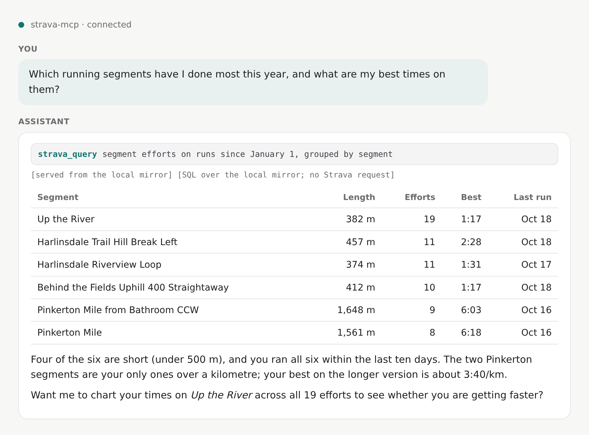
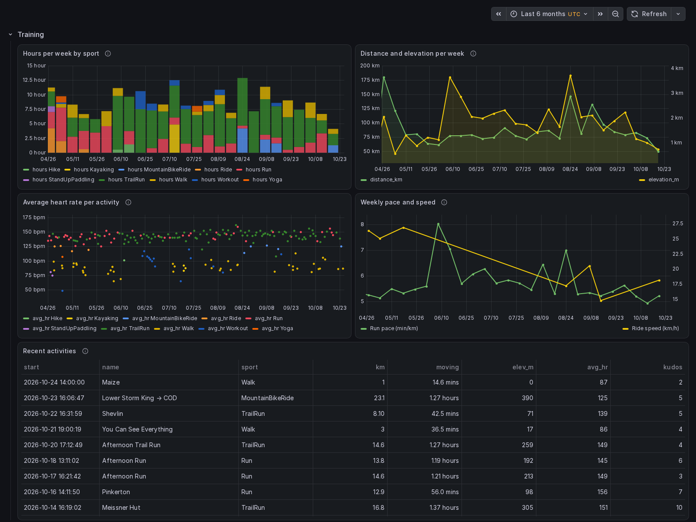

# strava-mcp

**Ask an AI assistant anything about your Strava history, answered in milliseconds from a complete local mirror of your account.**

strava-mcp is a self-hosted [MCP](https://modelcontextprotocol.io/) server for one athlete's own Strava data. A background sync copies everything Strava's API returns for the account into a single [DuckDB](https://duckdb.org/) file, within Strava's rate limits; the tools, resources and prompts answer from that file, and a read-only snapshot of it feeds dashboards, notebooks and backups.

[Get started](quickstart.md){ .md-button .md-button--primary }
[GitHub](https://github.com/justmytwospence/strava-mcp){ .md-button }

=== "Ask in plain language"

    

=== "Grafana dashboard"

    

-   :material-database:{ .lg .middle } **A complete mirror**

    ---

    Every activity with laps, splits, best efforts and segment efforts; full-resolution streams; zones; kudos, comments, photos; gear, segments, routes, clubs, the profile and a history of its totals. Stored verbatim, versioned when it changes, projected into typed tables with a description on every column.

    [:octicons-arrow-right-24: The mirror and the snapshot](data/index.md)

-   :material-speedometer:{ .lg .middle } **Rate-limit aware sync**

    ---

    Usage comes from Strava's headers on every response. Background work takes at most 75% of each window and spreads it over the day, so your questions always have budget left. A webhook delivers new activities in seconds.

    [:octicons-arrow-right-24: How sync works](sync.md)

-   :material-flash:{ .lg .middle } **Cache-first tools, plus SQL**

    ---

    33 tools answer from the mirror and fetch from Strava only when the stored copy is stale for its kind. `strava_query` runs read-only DuckDB SQL over the whole account; `strava_schema` describes it. Every answer says where it came from.

    [:octicons-arrow-right-24: Tools reference](reference/tools.md)

-   :material-chart-line:{ .lg .middle } **A snapshot anything can read**

    ---

    DuckDB has one writer, so the server publishes a consistent read-only copy and, optionally, serves it over HTTP. Grafana, a marimo notebook and scheduled backups ship as Compose profiles; your own tools attach it the same way.

    [:octicons-arrow-right-24: Grafana, notebooks, backups](extras.md)

-   :material-shield-lock:{ .lg .middle } **Bearer token or your identity provider**

    ---

    A bearer token protects the endpoint by default. The `oauth` profile puts an OAuth 2.1 gateway in front so claude.ai, Claude Code, Cursor and others sign in through your own OIDC provider.

    [:octicons-arrow-right-24: Authentication](authentication.md)

-   :material-docker:{ .lg .middle } **Self-hosted, one command**

    ---

    One container, one volume, `docker compose up -d`. Images for amd64 and arm64; an npm package for running over stdio without Docker.

    [:octicons-arrow-right-24: Quickstart](quickstart.md)

## Things you can ask

- "How did my weekly running volume change over the last three months, and was the long run getting longer?"
- "Compare all my efforts on segment 1234 and tell me whether the improvement is pace or heart rate."
- "What was my heart-rate drift in yesterday's long run, first half against second half?"
- "Which bike has the most kilometres this year, and when did I last ride each one?"
- "List every ride over 100 km with more than 2,000 m of climbing, newest first."
- "How much time did I spend in zone 4 and above this week compared with the same week last year?"
- "Find activities where my cadence dropped below 80 for more than five minutes."
- "Export the GPX of my starred route called 'Sunday loop'."
- "Rename this morning's ride to 'Coffee ride' and mark it as a commute."
- "What is the sync status: how much of my history is mirrored, and how much of today's API budget is left?"

The answers to the first seven are single SQL queries over the typed tables rather than dozens of API calls; the [prompts](reference/tools.md#prompts) package the common analyses.

## Why a mirror

A stateless MCP server calls Strava for every question. That is slow, it burns through the default limits (100 reads per 15 minutes, 1,000 a day) in one long conversation, and it cannot answer anything that spans years without hundreds of requests. A mirror turns that around: the data is fetched once, in the background, and every question after that is a local query. It also means the raw payloads are kept as received, so a field Strava adds later is already on disk, and an edit on Strava is a new version rather than a lost one.

## Compared with live-API servers

Several MCP servers for Strava call the API on every tool call, for example [r-huijts/strava-mcp](https://github.com/r-huijts/strava-mcp). They are a good fit for a quick look at recent activities from a laptop. The trade-offs are roughly:

| | strava-mcp (this project) | Live-API servers |
|---|---|---|
| Where it runs | An always-on host (Docker Compose), or locally over stdio | Locally, spawned by the client |
| Setup | A Strava API application, one authorization command, one container | A Strava API application and a config entry |
| Answer time | Milliseconds from the mirror | One or more API round trips per call |
| API budget | Background sync paced within the limits; questions cost nothing once mirrored | Every question spends requests; long conversations can hit 429 |
| Questions spanning years | One SQL query | Many paged calls, often impractical |
| Full-resolution streams | Mirrored for every activity | Fetched per activity on request |
| Edit history and deleted activities | Kept as versions and `deleted_at` | Not available |
| Dashboards and notebooks | A DuckDB snapshot, Grafana and marimo profiles | Not in scope |
| Disk and memory | Hundreds of MB per thousand activities, about 1 GB RAM | Negligible |
| Freshness | Webhook or polling; some kinds of data are deliberately cached for hours or days | Always live |

## Requirements

!!! info "What you need"

    - A host that stays on: the sync runs for days on a large account and the webhook needs a reachable server. A small VPS, a home server or a NAS with Docker is enough.
    - Docker with Compose v2.24 or later, for the Compose file as shipped. Images are built for `linux/amd64` and `linux/arm64`.
    - A [Strava API application](https://www.strava.com/settings/api) of your own (free; Strava may require a subscription for API access, see the FAQ).
    - About 1 GB of RAM for the container (DuckDB's limit is 384 MB by default) and, roughly, 250 MB of disk per 1,000 activities with streams, twice that with the snapshot.
    - Without Docker: Node 22 or later and the npm package, for a single-user stdio setup.

!!! warning "Strava's API terms"

    Strava's [API Agreement](https://www.strava.com/legal/api) and [API Policy](https://www.strava.com/legal/api_policy) restrict what an application may do with Strava data: among other things they limit caching to seven days, prohibit storing it in persistent databases and indexes, and reserve agent-mediated interfaces such as MCP servers to Strava's own. strava-mcp mirrors a single athlete's own data onto that athlete's own hardware, which is exactly what those clauses are about. Read the terms, the [brand guidelines](https://developers.strava.com/guidelines/) and the [FAQ](faq.md#is-this-allowed-under-stravas-terms), and decide for yourself before using it. This project is not affiliated with or endorsed by Strava.

## Works well with garmin-mcp

[garmin-mcp](https://justmytwospence.github.io/garmin-mcp/) is the sibling project for Garmin Connect: the same idea (a complete DuckDB mirror, cache-first tools, a snapshot) over the data Garmin holds and Strava does not: sleep, HRV, Body Battery, training status, the original FIT files. Its optional [Strava sync](https://justmytwospence.github.io/garmin-mcp/strava-sync/) reads this server's [export endpoint](reference/export.md) to rename Garmin activities after their Strava names and to remove the courses Strava created for routes you have unstarred, without spending any Strava API quota. See [garmin-mcp and the export](integrations/garmin-mcp.md).
