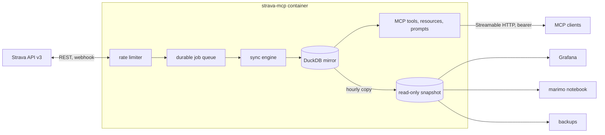

# strava-mcp

An [MCP](https://modelcontextprotocol.io/) server for your own Strava account, backed by a complete local mirror of everything Strava's API returns for it, in one [DuckDB](https://duckdb.org/) file. Tools answer from the mirror in milliseconds and cost no API requests; a background sync keeps it complete and fresh within Strava's rate limits; a read-only snapshot of the same file feeds dashboards, notebooks and backups.

It runs as one container. Grafana, a marimo notebook, an OAuth gateway and scheduled backups are optional Compose profiles.

## What it does

- **Mirrors everything.** Every activity (summary and full detail: laps, splits, best efforts, every segment effort), full-resolution streams, heart-rate and power zones, kudos, comments, photos, gear, segments and their geometry, starred segments, routes and their geometry, clubs, the athlete profile and zones, and a history of the athlete's totals.
- **Keeps the raw truth.** Each response is stored verbatim, a new version only when it changed, so the mirror is also an edit history. Typed tables with a description and unit on every column are projected from it and can be rebuilt at any time.
- **Stays within the rate limits.** Usage is read from Strava's rate-limit headers on every response. Background work takes at most 75% of each window and spreads it over the day; a person asking a question is never starved. A 429 pauses everything until the window resets.
- **Answers cache-first.** Tools serve the stored copy when it is fresh for its kind, fetch otherwise, and fall back to the stored copy when Strava cannot be reached. Every answer says where it came from.
- **Learns of changes fast.** New, edited and deleted activities arrive within seconds through a Strava webhook when you have a public URL, or by polling every 15 minutes when you do not.
- **Lets anything else read the data.** DuckDB allows one writer, so the server publishes a consistent read-only copy next to the mirror and, optionally, over HTTP. Query it with `strava_query` (SQL from the model), Grafana, marimo, or any DuckDB client.
- **Writes carefully.** Creating or updating activities, starring segments and uploading files go to Strava first; what Strava returns is stored, never an optimistic guess.

## Where to go

- [Quickstart](quickstart.md): a Strava API app, one authorization command, `docker compose up -d`.
- [Clients](clients.md): Claude Code, Claude Desktop, claude.ai, Cursor and pi.
- [How sync works](sync.md): priorities, rate-limit shares, freshness rules, the webhook.
- [The mirror and the snapshot](data/index.md) and the [schema reference](data/schema.md).
- [Extras](extras.md): Grafana, notebooks, backups, or your own tools over the snapshot.
- [Operations](operations.md): memory sizing, upgrades, troubleshooting.
- [Tools reference](reference/tools.md): every tool, resource and prompt.

!!! note "Strava's terms"
    Strava's API Agreement restricts caching beyond seven days and use with AI applications other than Strava's own. This server is built for a single athlete's own data; whether that use is acceptable under the agreement is yours to judge.
